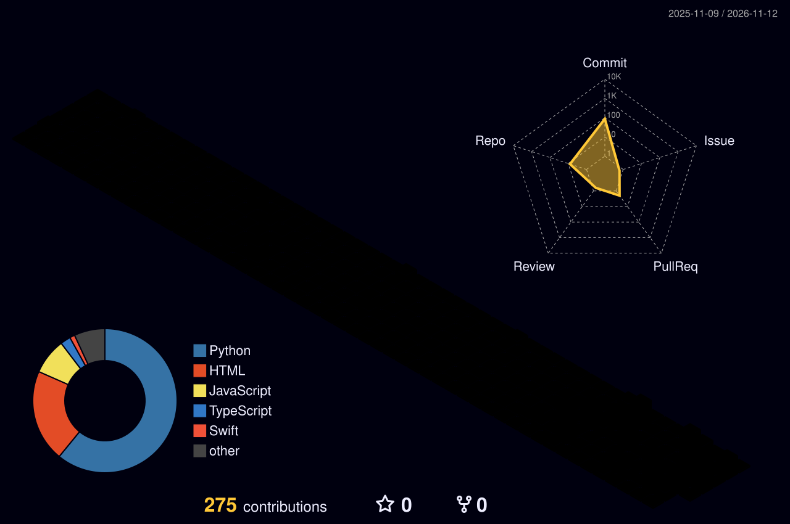

<p align="center">
  
</p>

<p align="center">
  <a href="https://tutumtetwa.com">
    
  </a>
</p>

<p align="center">
  <a href="https://tutumtetwa.com"></a>
  <a href="https://www.linkedin.com/in/tutu-mtetwa"></a>
  <a href="mailto:tutumtetwa@gmail.com"></a>
  <a href="https://leetcode.com/u/Tutu_M/"></a>
  <a href="https://github.com/tutumtetwa/neetcode-submissions"></a>
</p>

<p align="center">
  
  
</p>

---

## 🧬 About Me

```yaml
name:       Tutu Mtetwa
school:     Truman State University, B.S. Computer Science (Dec 2026)
community:  ColorStack · NSBE · 2x Google G-SWEP mentee
focus:      backend systems, full-stack products, applied AI, automation
shipped:    12+ projects live: web, iOS and ML
```

I build software that feels intuitive and solves real problems, from scripting tools and ML models to full-stack apps people actually use.

---

## 🛠 Tech Stack

<table>
  <tr>
    <td><b>Languages</b></td>
    <td>
      
      
      
      
      
      
      
      
      
    </td>
  </tr>
  <tr>
    <td><b>Frontend</b></td>
    <td>
      
      
      
      
      
      
      
    </td>
  </tr>
  <tr>
    <td><b>Backend</b></td>
    <td>
      
      
      
      
      
      
    </td>
  </tr>
  <tr>
    <td><b>Data &amp; AI</b></td>
    <td>
      
      
      
      
      
      
      
    </td>
  </tr>
  <tr>
    <td><b>Cloud &amp; Tools</b></td>
    <td>
      
      
      
      
      
      
    </td>
  </tr>
</table>

---

## 🚀 Featured Projects

<table>
  <tr>
    <td width="50%" valign="top">
      <h3>📈 AlphaTest</h3>
      Trading-strategy backtester on real market data: SMA/EMA, RSI, MACD, Bollinger and ICT strategies, Sharpe/drawdown analytics and candle-by-candle replay. One-click demo login.<br/><br/>
      
      
      <br/><br/>
      <a href="https://alphatest-olive.vercel.app">🔗 Live</a> · <a href="https://github.com/tutumtetwa/backtest">💻 Code</a>
    </td>
    <td width="50%" valign="top">
      <h3>🗓 Office Hours Platform</h3>
      Full-stack booking app with student, instructor and admin roles, waitlists with automatic notifications, and JWT auth.<br/><br/>
      
      
      <br/><br/>
      <a href="https://officehours-web.vercel.app">🔗 Live</a> · <a href="https://github.com/tutumtetwa/office-hours-platform">💻 Code</a>
    </td>
  </tr>
  <tr>
    <td width="50%" valign="top">
      <h3>🧠 NoteGrid</h3>
      AI study-notes app: upload a PDF/DOCX or paste text and get a DistilBART summary, sentiment analysis, text-to-speech audio and PDF/TXT export.<br/><br/>
      
      
      <br/><br/>
      <a href="https://notegrid.live">🔗 Live</a> · <a href="https://github.com/tutumtetwa/notegrid">💻 Code</a>
    </td>
    <td width="50%" valign="top">
      <h3>🥗 ZiPack</h3>
      Native iOS nutrition and meal-planning assistant. Gemini generates recipes and meal plans from your profile and expiring pantry items.<br/><br/>
      
      
      <br/><br/>
      <a href="https://zipack-42721.web.app">🔗 Web</a> · <a href="https://github.com/tutumtetwa/ZiPackIOS">💻 iOS Code</a>
    </td>
  </tr>
  <tr>
    <td width="50%" valign="top">
      <h3>🌐 CodePulse</h3>
      Real-time developer forum with live Firestore sync across clients and fine-grained auth and access control.<br/><br/>
      
      
      <br/><br/>
      <a href="https://devconnect-forum.web.app">🔗 Live</a> · <a href="https://github.com/tutumtetwa/devconnect-client">💻 Code</a>
    </td>
    <td width="50%" valign="top">
      <h3>🔍 AlgoVis</h3>
      Step through 15 interview patterns and 60+ problems (sliding window, heaps, tries, BFS, backtracking, DP) with animated data structures and line-by-line code highlighting.<br/><br/>
      
      
      <br/><br/>
      <a href="https://algovis-iota.vercel.app">🔗 Live</a> · <a href="https://github.com/tutumtetwa/algovis">💻 Code</a>
    </td>
  </tr>
  <tr>
    <td width="50%" valign="top">
      <h3>🛡 VERDICT</h3>
      Phishing and SMS-scam detector: a TF-IDF + Naive Bayes classifier combined with link expansion, geo-lookup, homoglyph and burner-number forensics. SSRF- and XSS-hardened.<br/><br/>
      
      
      <br/><br/>
      <a href="https://verdict-scanner-chi.vercel.app">🔗 Live</a> · <a href="https://github.com/tutumtetwa/VERDICT">💻 Code</a>
    </td>
    <td width="50%" valign="top">
      <h3>🚗 Chicago Repair Directory</h3>
      Team data project: a sourced directory of licensed independent repair shops on Chicago's North Side, built from City of Chicago license data.<br/><br/>
      
      <br/><br/>
      <a href="https://github.com/tutumtetwa/430-project-1">💻 Code</a>
    </td>
  </tr>
</table>

<details>
  <summary><b>📂 More projects</b> (click to expand)</summary>
  <br/>

| Project | What it does | Stack | Link |
|---|---|---|---|
| 🍞 **BreadBook** | Trading journal with a real-time P&amp;L dashboard, goal tracking and trade screenshots | React · Tailwind · Recharts · Firebase | [Live](https://bankroll-7dd6f.web.app) |
| 📋 **Planna** | Real-time collaborative Kanban board with a custom drag-and-drop system | React · Node · Express · Firebase | [Live](https://planna-b1e3a.web.app) |
| 💹 **Crashers** | Real-time crypto tracker with watchlists, search and a news feed | React · Crypto APIs | [Live](https://crashers.netlify.app) · [Code](https://github.com/tutumtetwa/Crashers) |
| ⚽ **Soccer Score Predictor** | ML model that forecasts match results with **62.5% accuracy** | Python · ML | [Colab](https://colab.research.google.com/drive/1gpITank7HbGSBKx-zZ6ZzptD1ERXSS2v?usp=sharing) |
| 💱 **FX Sprinter** | KNN forecaster for EUR/USD, plus a write-up on overfitting in volatile markets | Python · KNN | [Colab](https://colab.research.google.com/drive/1GaOuUOL3zOjEu65GGWN9og5njT5znURe?usp=sharing) |
| 🗂 **Manager App** | C++ desktop app for managing database records with full CRUD | C++ | [Code](https://github.com/tutumtetwa/Manager-App) |

</details>

<p align="center">
  <a href="https://tutumtetwa.com"></a>
</p>

---

## 📊 GitHub Stats

<p align="center">
  <picture>
    <source media="(prefers-color-scheme: dark)" srcset="./profile-3d-contrib/profile-night-rainbow.svg"/>
    <source media="(prefers-color-scheme: light)" srcset="./profile-3d-contrib/profile-green-animate.svg"/>
    
  </picture>
</p>

<p align="center">
  
</p>
<p align="center">
  
  
</p>
<p align="center">
  
</p>
<p align="center">
  <a href="https://leetcode.com/u/Tutu_M/">
    
  </a>
</p>

---

## 🎧 Now Playing

<p align="center">
  <a href="https://open.spotify.com/user/31jeqlykehbwyrhxy32ppjonk2ba">
    
  </a>
</p>

<details>
  <summary>🔥 Not playing right now? Here's who's always on loop</summary>
  <br/>
  <table align="center">
    <tr>
      <td align="center"><br/>🎤 <b>Rod Wave</b></td>
      <td align="center"><br/>🥷🏾 <i>Rodarius Green</i></td>
    </tr>
    <tr>
      <td align="center"><br/>🎙 <i>Rodarius Marcel Green</i></td>
      <td align="center"><br/>🎧 <i>Nuni</i></td>
    </tr>
  </table>
</details>

---

## 🧃 A Few More Things

- 🔭 I turn late-night ideas into polished products.
- 🎨 I treat code like art, with functionality as the frame.
- 🌱 Currently diving into scalable architectures, cloud-native apps and LLM tooling.
- 🤝 Open to collaborating on developer tools, fintech and AI products.
- 📫 Fastest way to reach me: **[tutumtetwa@gmail.com](mailto:tutumtetwa@gmail.com)**

> _"Before you get one win, you gotta take a thousand losses."_ (Rod Wave)

<p align="center">
  <picture>
    <source media="(prefers-color-scheme: dark)" srcset="https://raw.githubusercontent.com/tutumtetwa/tutumtetwa/output/snake-dark.svg"/>
    <source media="(prefers-color-scheme: light)" srcset="https://raw.githubusercontent.com/tutumtetwa/tutumtetwa/output/snake-light.svg"/>
    
  </picture>
</p>

<p align="center">
  
</p>
